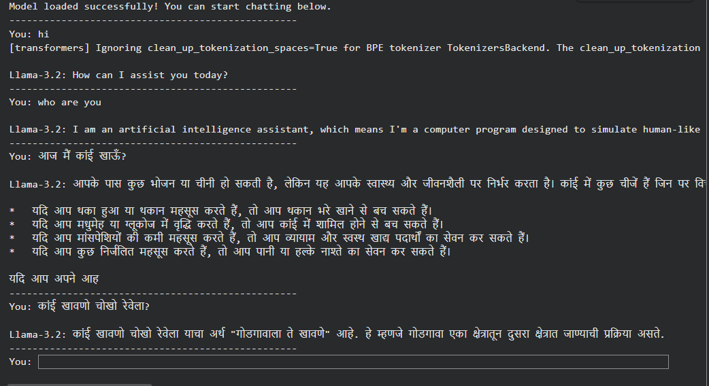
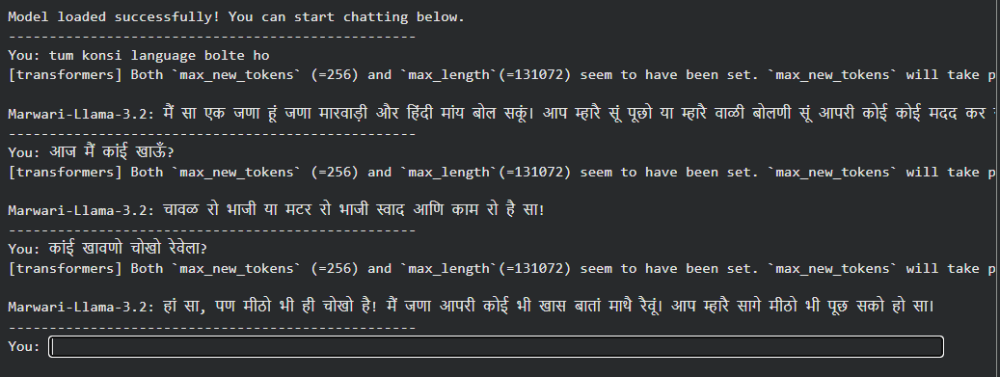
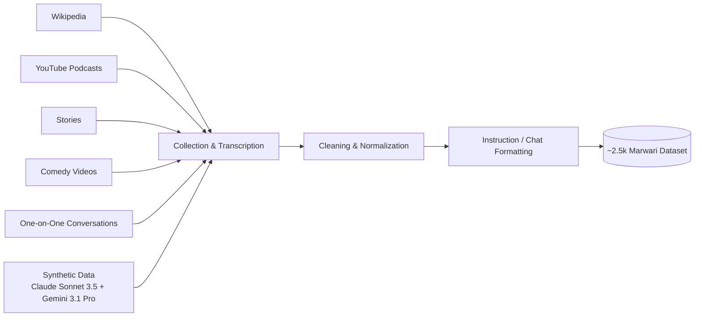
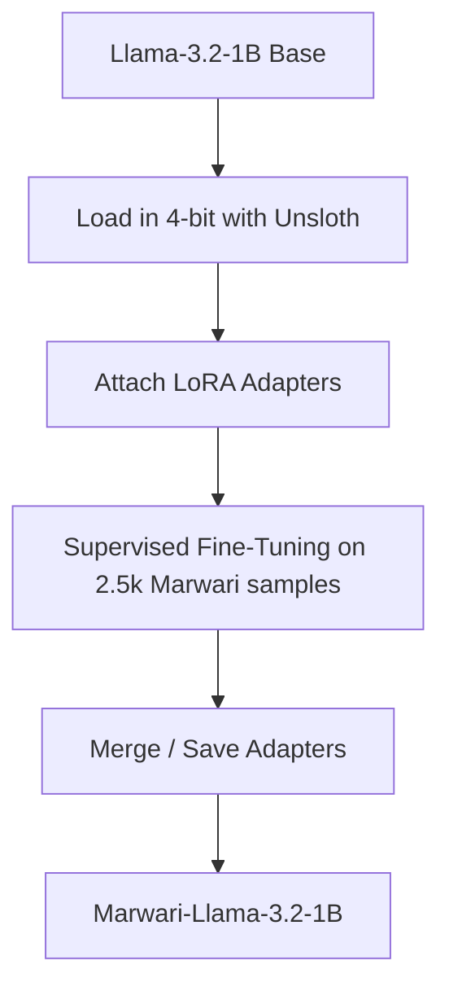
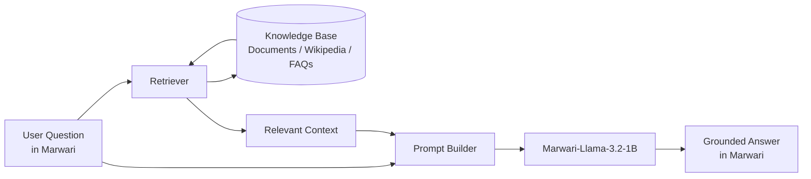

<div align="center">

# 🐪 Marwari-Llama-3.2-1B

### Parameter-Efficient Domain & Language Adaptation for Low-Resource Indic Dialects

*A low-latency, 1B-parameter LLM that understands and speaks **Marwari (मारवाड़ी)**, with its honorifics and grammar intact.*


-red)


</div>

---

## 📌 Table of Contents

1. [Overview](#-overview)
2. [Highlights](#-highlights)
3. [Why Marwari?](#-why-marwari)
4. [Demo: Base Model vs Fine-Tuned Model](#-demo-base-model-vs-fine-tuned-model)
5. [Dataset & Data Sources](#-dataset--data-sources)
6. [Methodology](#-methodology)
7. [Training Results](#-training-results)
8. [Installation & Usage](#-installation--usage)
9. [Limitations](#-limitations)
10. [Roadmap: RAG Integration](#-roadmap-rag-integration)
11. [Project Structure](#-project-structure)
12. [Acknowledgements](#-acknowledgements)
13. [Author](#-author)

---

## 🌟 Overview

**Marwari-Llama-3.2-1B** is a fine-tuned version of **Meta's Llama-3.2-1B** that can understand and respond in **Marwari**, a low-resource Indo-Aryan language spoken mainly in Rajasthan, India. Marwari has very little digital text, and mainstream LLMs usually mistake it for Hindi or another neighbouring language.

This project shows that a **small, efficient 1B model** can be adapted to a low-resource dialect using:

- **QLoRA** (4-bit quantized Low-Rank Adaptation) for parameter-efficient training
- **Unsloth** for fast, memory-efficient fine-tuning
- A **targeted, hand-curated dataset of ~2.5k samples** instead of a massive corpus

The result is a lightweight model that runs on modest hardware and keeps Marwari **honorifics (e.g. "सा")** and **grammatical structure**.

---

## ✨ Highlights

| | |
|---|---|
| 🧠 **Model size** | 1B parameters (Llama-3.2-1B-Instruct) |
| ⚡ **Latency** | Low-latency, suitable for consumer GPUs and edge deployment |
| 🔧 **Technique** | QLoRA + Unsloth |
| 📚 **Dataset** | ~2.5k targeted Marwari samples |
| 📉 **Training loss** | **~70% reduction** |
| 🗣️ **Language fidelity** | Preserves dialectal honorifics and grammar |
| 🔮 **Next step** | Retrieval-Augmented Generation (RAG) for grounded answers |

---

## 🏜️ Why Marwari?

- Marwari is spoken by millions of people, yet it is **severely under-represented** in NLP resources.
- General-purpose LLMs often **confuse it with Hindi, Rajasthani, or Marathi**, as the base-model screenshots below show.
- Dialects carry **cultural identity**: honorifics, respectful address, and idioms are lost when a model "translates" everything into standard Hindi.
- Small, specialized models make **local-language AI accessible**, with no big GPU cluster needed.

---

## 🖼️ Demo: Base Model vs Fine-Tuned Model

The screenshots below are from interactive terminal chat sessions with each model. Both were asked the same Hindi/Marwari questions.

> 📁 Save your screenshots in an `assets/` folder as `base_llama_3.2.png` and `marwari_llama_3.2.png` so the images render on GitHub.

### 🔹 Before: Base Llama-3.2-1B (no fine-tuning)

<div align="center">
  
</div>

**What we observe:**

- The base model answers the Hindi question `आज मैं कांई खाऊँ?` with generic Hindi text. It misreads *कांई* (Marwari for "what") and talks about "कांई" as if it were a food item.
- When asked the Marwari question `कांई खावणो चोखो रेवेला?` ("What would be good to eat?"), it **mistakes the language for Marathi** and gives an irrelevant, incorrect explanation.
- ❌ It does **not** understand Marwari vocabulary, and it **cannot respond in Marwari**.

### 🔹 After: Marwari-Llama-3.2-1B (fine-tuned)

<div align="center">
  
</div>

**What we observe:**

- Asked in **Romanized Hindi** (`tum konsi language bolte ho`), the model says it can speak **Marwari and Hindi**, and it replies in Marwari with phrases like *"म्हारै सूं पूछो"* and *"आपरी कोई कोई मदद कर…"*.
- For `आज मैं कांई खाऊँ?` it suggests a food item in Marwari-style phrasing and ends with the honorific **"सा"**.
- For `कांई खावणो चोखो रेवेला?` it correctly reads the question as being about food and replies in the dialect, again using **"सा"**.
- ✅ The model **understands Marwari input**, **responds in Marwari**, and **keeps the respectful tone** typical of the dialect.

### 📊 Side-by-Side Summary

| Prompt | Base Llama-3.2-1B | Marwari-Llama-3.2-1B |
|---|---|---|
| `tum konsi language bolte ho` | Not tested | ✅ Replies in Marwari, says it speaks Marwari and Hindi |
| `आज मैं कांई खाऊँ?` | Generic Hindi answer that misreads "कांई" | ✅ Food suggestion in Marwari style with "सा" |
| `कांई खावणो चोखो रेवेला?` | ❌ Treated as Marathi, irrelevant answer | ✅ Contextually relevant Marwari reply |
| Honorifics ("सा") | ❌ Absent | ✅ Present |
| Dialect identification | ❌ Hindi / Marathi confusion | ✅ Marwari |

---

## 📚 Dataset & Data Sources

Marwari has very little clean digital text, so the dataset was **built from scratch** from several sources to cover different registers, from formal to casual and conversational.

| # | Source | What it contributes |
|---|---|---|
| 1 | 📖 **Wikipedia** | Formal, factual, encyclopedic Marwari text |
| 2 | 🎙️ **YouTube Podcasts** | Natural, long-form spoken Marwari |
| 3 | 📜 **Stories** | Folk tales and narrative style, with idioms and cultural context |
| 4 | 😂 **Comedy Videos** | Colloquial, expressive, everyday speech |
| 5 | 💬 **One-on-One Conversations** | Real dialogue patterns, turn-taking, honorifics |
| 6 | 🤖 **Synthetic Data** | Generated with **Claude Sonnet 3.5** and **Gemini 3.1 Pro** to widen topic and instruction coverage |

**Final dataset size:** ~**2.5k** curated samples

### 🔄 Data Pipeline



---

## 🛠️ Methodology

### Why QLoRA?

Full fine-tuning of even a 1B model is wasteful when only a small dialect dataset is available. **QLoRA** loads the base model in 4-bit precision and trains only small low-rank adapter matrices. This brings:

- 💾 **Much lower VRAM use**, so it trains on a single consumer or free-tier GPU
- 🧩 **Small adapter files** that are easy to share and swap
- 🛡️ **Less catastrophic forgetting**, since the base weights stay frozen

### Why Unsloth?

[Unsloth](https://github.com/unslothai/unsloth) makes LoRA/QLoRA fine-tuning significantly **faster and lighter on memory**, which suits quick iteration on a small dataset.

### Training Pipeline



### Configuration

> ⚠️ Replace the placeholders below with the actual values from your training run.

| Parameter | Value |
|---|---|
| Base model | `Llama-3.2-1B-Instruct` |
| Fine-tuning method | QLoRA (4-bit) |
| Framework | Unsloth |
| LoRA rank (r) | `16` |
| LoRA alpha | `32` |
| Learning rate | `2e-4` |
| Epochs | `2` |
| Batch size | `8` |
| Max new tokens (inference) | 256 |
| Hardware | `Google Colab (free tier), NVIDIA T4 GPU, 16 GB VRAM` |

---

## 📈 Training Results

| Metric | Result |
|---|---|
| Training loss reduction | **~70%** 📉 |
| Dialect fidelity | Honorifics and grammar preserved |
| Language identification | Responds in Marwari instead of Hindi or Marathi |

<!-- Optional: add your loss curve
<div align="center">
  
</div>
-->

---

## 🚀 Installation & Usage

### 1. Clone the repository

```bash
git clone https://github.com/aarinnahar/Marwari-Llama-3.2-1B.git
cd Marwari-Llama-3.2-1B
```

### 2. Install dependencies

```bash
pip install unsloth transformers peft bitsandbytes accelerate torch
```

### 3. Run inference

The fine-tuned model is **not stored in this GitHub repo**. It is hosted on Hugging Face and downloads automatically the first time you run the code:

👉 **[huggingface.co/aarinnahar/Marwari-Llama-3.2-1B](https://huggingface.co/aarinnahar/Marwari-Llama-3.2-1B)**

```python
from unsloth import FastLanguageModel

model, tokenizer = FastLanguageModel.from_pretrained(
    model_name="aarinnahar/Marwari-Llama-3.2-1B",  
    max_seq_length=2048,
    load_in_4bit=True,
)
FastLanguageModel.for_inference(model)

prompt = "कांई खावणो चोखो रेवेला?"
inputs = tokenizer(prompt, return_tensors="pt").to("cuda")
outputs = model.generate(**inputs, max_new_tokens=256)
print(tokenizer.decode(outputs[0], skip_special_tokens=True))
```

### 4. Interactive chat (as shown in the screenshots)

```bash
python chat.py
```

> Use `max_new_tokens` alone and leave `max_length` unset to avoid the transformers warning visible in the screenshot.

---

## ⚠️ Limitations

- 🧠 **Knowledge limit:** At 1B parameters the model has little world knowledge, so it **can hallucinate facts**.
- 📏 **Small dataset:** About 2.5k samples gives good dialect style but limited coverage of topics.
- 🔀 **Dialect mixing:** Marwari shares vocabulary with Hindi, Rajasthani, and Marathi, so an occasional word from a neighbouring language can slip into a reply.
- 🍲 **Not for critical use:** Do not use it for medical, legal, or financial advice.

These limits are the reason for the next step below.

---

## 🔮 Roadmap: RAG Integration

Because this is a small 1B model, its **built-in knowledge is limited**. Instead of making the model memorize facts, the plan is to split the work:

> 🗣️ **The model speaks Marwari** (language, tone, honorifics)
> 📚 **RAG supplies the facts** (a retrieved, trusted knowledge base)



### Planned Steps

- [ ] Build a vector store from trusted source documents
- [ ] Add a multilingual embedding model for Marwari/Hindi queries
- [ ] Integrate a retriever with the fine-tuned model
- [ ] Prompt the model to answer **only from retrieved context**
- [ ] Evaluate hallucination rate before and after RAG
- [ ] Expand the dataset beyond 2.5k samples
- [x] Publish the fine-tuned model on Hugging Face
- [ ] Create a simple web demo (Gradio / Streamlit)

**Expected benefit:** a model that keeps its low latency and its Marwari voice but gives **factually grounded, trustworthy answers**.

---

## 📂 Project Structure

```
Marwari-Llama-3.2-1B/
├── assets/
│   ├── base_llama_3.2.png        # Base model screenshot
│   └── marwari_llama_3.2.png     # Fine-tuned model screenshot
├── data/                         # Dataset 
├── notebooks/                    # Training notebook(s)
├── chat.py                       # Interactive chat script
├── requirements.txt
└── README.md
```

> 🤗 Model weights live on Hugging Face, not in this repository.

---

## 🙏 Acknowledgements

- [Meta AI](https://ai.meta.com/) for Llama 3.2
- [Unsloth](https://github.com/unslothai/unsloth) for efficient fine-tuning
- [Hugging Face](https://huggingface.co/) 🤗 for Transformers, PEFT, and the model hub
- Anthropic (Claude Sonnet 3.5) and Google (Gemini 3.1 Pro) for synthetic data generation
- The Marwari-speaking community, whose content made this dataset possible

---

## 👤 Author

**`Aarin Nahar`**

[](https://github.com/aarinnahar)
[](https://linkedin.com/in/aarinnahar)

---

<div align="center">

⭐ If you like this project, consider giving it a star! ⭐

*Made with ❤️ for the Marwari language and community.*

</div>
